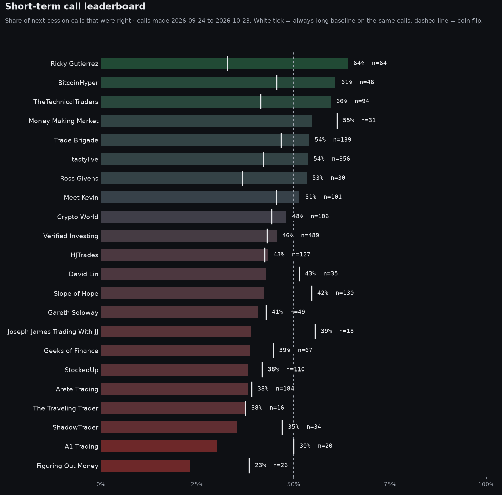
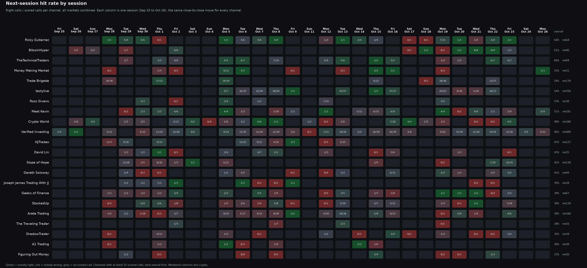
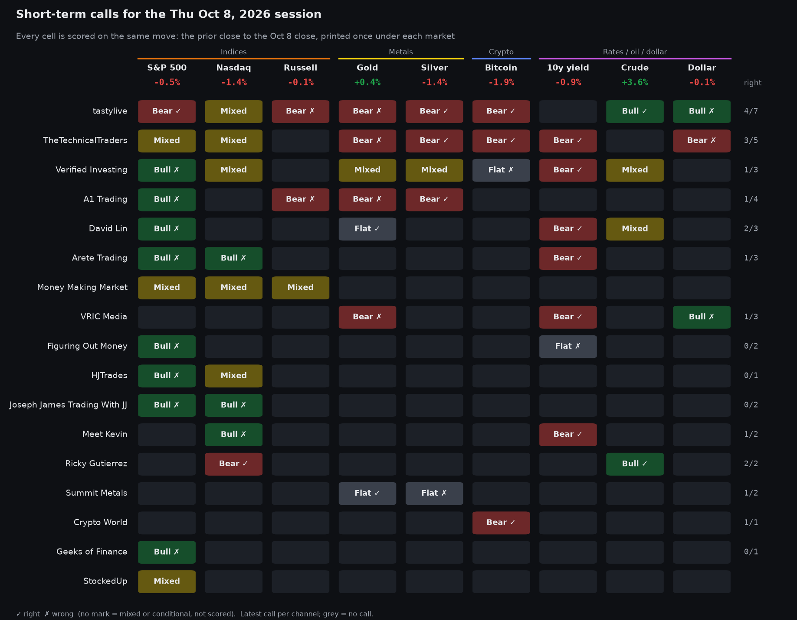
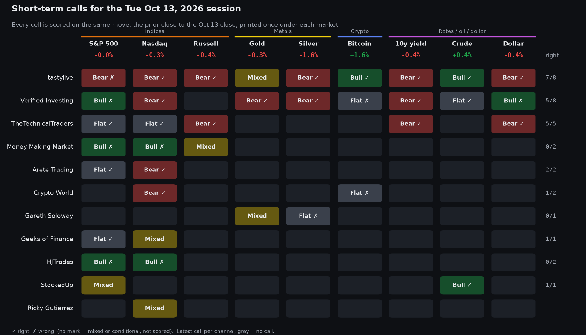
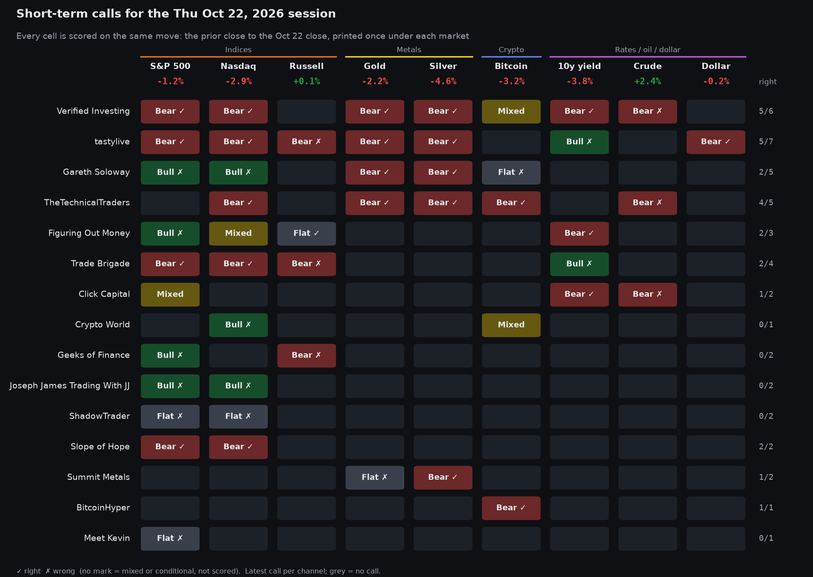
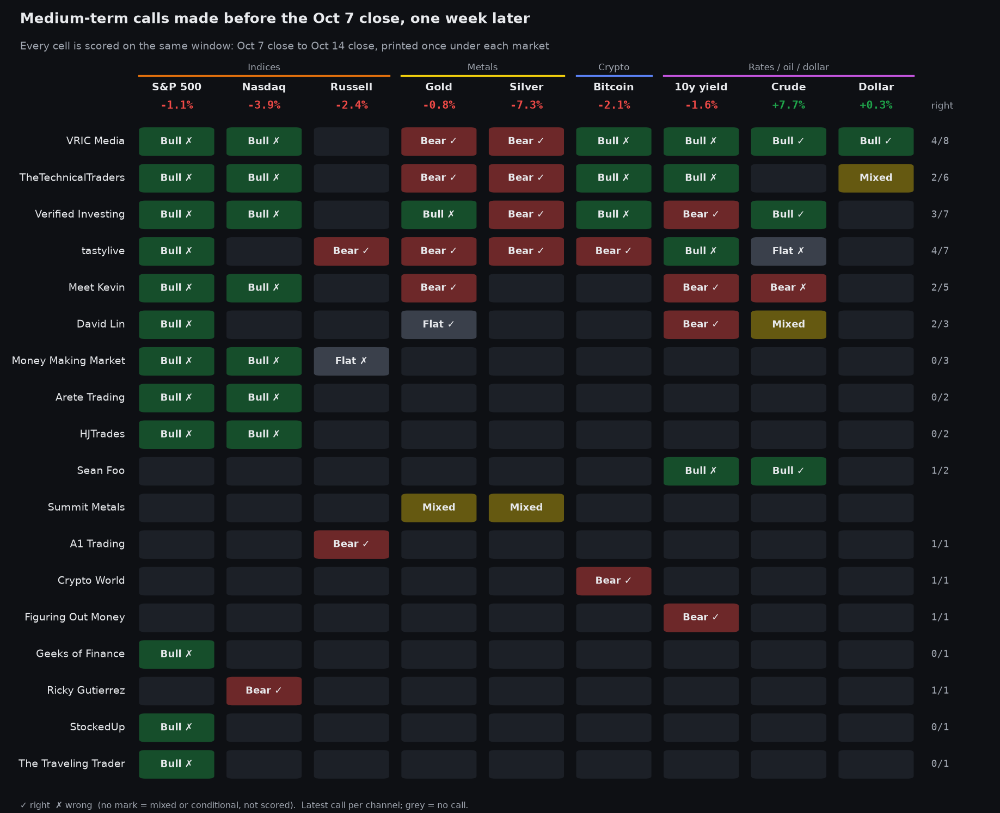
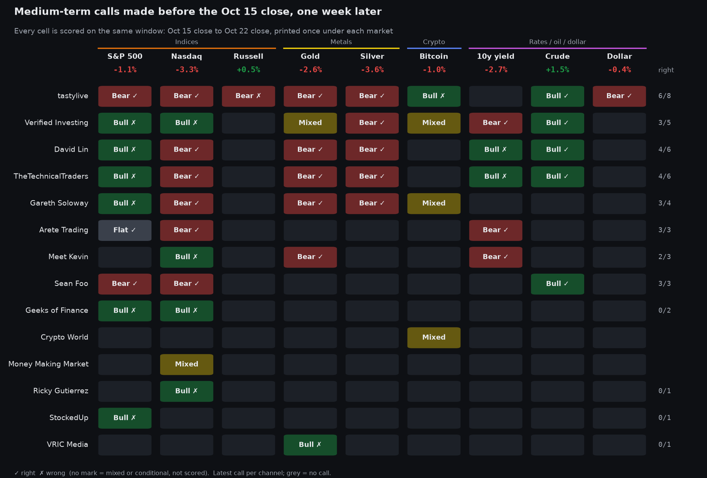

# youtube-call-scoreboard

**How often are YouTube market channels right about the next session?**

This repo extracts the short-term calls (bullish / bearish / neutral) that trading and market-analysis channels make
in their videos, scores each one against what the market actually did, and publishes every call, quote, timestamp
and score so creators and viewers can audit the result.

> **Not financial advice.** Scores reflect only each channel's *stated short-term bias* over a short pilot window.
> They say nothing about a channel's long-term views, education value, or trading performance.

## Pipeline

```
 channels.yaml
      │  ytscore ingest      YouTube captions (youtube-transcript-api) → rolling-caption dedupe
      ▼                       → transcripts/<id>.txt   (local only, git-ignored, never published)
 transcripts/
      │  ytscore extract     LLM (any OpenAI-compatible endpoint, e.g. OpenRouter) + prompts/extract.md
      ▼                       → validated JSON (pydantic), quotes ≤ 25 words
 data/calls/<id>.json
      │  ytscore score       Yahoo daily bars (yfinance) → reference close → next session / 1 week
      ▼                       → hit / miss with volatility thresholds, exclusions.yaml applied
 data/scored_calls.json
      │  ytscore leaderboard hit rate vs coin flip (binomial p) and vs an always-long baseline
      │  ytscore twins       same calls on random days (10,000 sets), Holm-corrected
      │  ytscore agree       agreement between two independent extraction passes
      │  ytscore chart       out/session_heatmap.png, out/leaderboard.png
      ▼
 leaderboard
```

## Quickstart

```bash
git clone https://github.com/humbleambition/youtube-trader-call-scoreboard
cd youtube-call-scoreboard
pip install -e ".[dev]"

# re-score the published calls exactly as in the snapshot below
ytscore score --asof 2026-10-31
ytscore leaderboard
ytscore chart
pytest

# process new videos
ytscore ingest --channels channels.yaml --days 2          # captions → transcripts/ (git-ignored)
cp .env.example .env                                      # add YTSCORE_LLM_API_KEY and YTSCORE_LLM_MODEL
ytscore extract transcripts/<id>.txt --channel "HJTrades" --date 2026-10-20
ytscore score && ytscore leaderboard && ytscore chart
```

Prices are cached in `.cache/prices/`. `--asof YYYY-MM-DD` uses only bars before that date, so a snapshot can be
re-created later (Yahoo occasionally revises past bars, so tiny differences are possible).

## Leaderboard: one fixed month (calls made 24 Sep – 23 Oct 2026)

Every video from every tracked channel in that window: 3,844 calls from 615 videos across 30 channels. Channels with at
least 15 scored next-session calls are ranked. "Always-long" is the share of the same calls where the market simply
rose; "edge" is hit rate minus that baseline. With 22 channels compared, p-values above ~0.0023 are not
distinguishable from luck — none clear that bar.

| # | Channel | Next-session hit rate | Scored calls | Always-long baseline | Edge vs long | p (vs coin flip) | 1-week hit rate (n) |
|---|---|---|---|---|---|---|---|
| 1 | Ricky Gutierrez | 64% | 64 | 33% | +31 pts | 0.016 | 43% (92) |
| 2 | BitcoinHyper | 61% | 46 | 46% | +15 pts | 0.092 | 47% (49) |
| 3 | TheTechnicalTraders | 60% | 94 | 41% | +18 pts | 0.040 | 54% (118) |
| 4 | Money Making Market | 55% | 31 | 61% | -6 pts | 0.360 | 53% (45) |
| 5 | Trade Brigade | 54% | 139 | 47% | +7 pts | 0.198 | 44% (151) |
| 6 | tastylive | 54% | 356 | 42% | +12 pts | 0.092 | 55% (454) |
| 7 | Ross Givens | 53% | 30 | 37% | +17 pts | 0.428 | 47% (83) |
| 8 | Meet Kevin | 51% | 101 | 46% | +6 pts | 0.421 | 54% (213) |
| 9 | Crypto World | 48% | 106 | 44% | +4 pts | 0.686 | 56% (118) |
| 10 | Verified Investing | 46% | 489 | 43% | +2 pts | 0.977 | 49% (577) |
| 11 | HJTrades | 43% | 127 | 43% | +1 pts | 0.945 | 42% (165) |
| 12 | David Lin | 43% | 35 | 51% | -9 pts | 0.845 | 49% (133) |
| 13 | Slope of Hope | 42% | 130 | 55% | -12 pts | 0.968 | 33% (207) |
| 14 | Gareth Soloway | 41% | 49 | 43% | -2 pts | 0.924 | 59% (56) |
| 15 | Joseph James Trading With JJ | 39% | 18 | 56% | -17 pts | 0.881 | 44% (18) |
| 16 | Geeks of Finance | 39% | 67 | 45% | -6 pts | 0.975 | 37% (83) |
| 17 | StockedUp | 38% | 110 | 42% | -4 pts | 0.995 | 53% (135) |
| 18 | Arete Trading | 38% | 184 | 39% | -1 pts | 1.000 | 49% (265) |
| 19 | The Traveling Trader | 38% | 16 | 38% | +0 pts | 0.895 | 36% (45) |
| 20 | ShadowTrader | 35% | 34 | 47% | -12 pts | 0.971 | 54% (37) |
| 21 | A1 Trading | 30% | 20 | 50% | -20 pts | 0.979 | 46% (28) |
| 22 | Figuring Out Money | 23% | 26 | 38% | -15 pts | 0.999 | 39% (33) |

### Random-day twin test

The coin flip is a loose yardstick: a call only counts as right when the move clears a threshold, so even random
calls hit less than 50%. The twin test is stricter and fairer. Every scored call gets a "twin" with the same
instrument, bias and threshold, scored on a random session from the previous ~6 months instead of the day it was
made; 10,000 twin sets per channel. The twin p-value is the share of twin sets that did at least as well as the real
calls, and the Holm correction accounts for testing 22 channels at once (`ytscore twins`, results in
`data/twins.json`).

Random-day twins hit about 46%. Three channels beat their twins clearly before correction (TheTechnicalTraders,
Ricky Gutierrez, tastylive, all p < 0.005), but after the Holm correction none reaches 5%: TheTechnicalTraders comes
closest at 0.055. One month is not enough to call it skill; it is enough to say these three are worth watching.

| # | Channel | Hit rate | Same calls on random days | Twin p | Holm-adjusted p |
|---|---|---|---|---|---|
| 1 | Ricky Gutierrez | 64% | 47% | 0.0044 | 0.092 |
| 2 | BitcoinHyper | 61% | 43% | 0.0118 | 0.224 |
| 3 | TheTechnicalTraders | 60% | 45% | 0.0025 | 0.055 |
| 4 | Money Making Market | 55% | 46% | 0.2036 | 1.000 |
| 5 | Trade Brigade | 54% | 47% | 0.0453 | 0.815 |
| 6 | tastylive | 54% | 47% | 0.0046 | 0.092 |
| 7 | Ross Givens | 53% | 46% | 0.2578 | 1.000 |
| 8 | Meet Kevin | 51% | 46% | 0.1725 | 1.000 |
| 9 | Crypto World | 48% | 44% | 0.2070 | 1.000 |
| 10 | Verified Investing | 46% | 45% | 0.3762 | 1.000 |
| 11 | HJTrades | 43% | 47% | 0.8420 | 1.000 |
| 12 | David Lin | 43% | 46% | 0.7144 | 1.000 |
| 13 | Slope of Hope | 42% | 47% | 0.9005 | 1.000 |
| 14 | Gareth Soloway | 41% | 47% | 0.8385 | 1.000 |
| 15 | Joseph James Trading With JJ | 39% | 46% | 0.7966 | 1.000 |
| 16 | Geeks of Finance | 39% | 46% | 0.9000 | 1.000 |
| 17 | StockedUp | 38% | 47% | 0.9727 | 1.000 |
| 18 | Arete Trading | 38% | 46% | 0.9848 | 1.000 |
| 19 | The Traveling Trader | 38% | 48% | 0.8605 | 1.000 |
| 20 | ShadowTrader | 35% | 46% | 0.9190 | 1.000 |
| 21 | A1 Trading | 30% | 45% | 0.9420 | 1.000 |
| 22 | Figuring Out Money | 23% | 48% | 0.9973 | 1.000 |

### Extraction agreement check

A second extraction pass re-read a random sample of 20 videos (seed 2026, from ranked channels) from the same public
prompt, blind to the published calls (`data/calls_check/`, compared with `ytscore agree`, results in
`data/agreement.json`).

- 89% of the published scorable calls (100 of 112) were found again; every one of those 100 had the same
  short-term bias.
- The second pass found more calls (152), mostly passing or hedged mentions the first pass left out, so only 66%
  of its calls are in the published set.
- Scored outcomes barely moved: 94 of 96 calls scored by both passes got the same verdict, and the sample's hit rate
  was 47% either way.

Caveat: both passes used the same family of model, so this measures consistency, not independence from model
bias. The main disagreement is over which borderline remarks count as calls, not over what direction a host called.






How each call is scored — reference close, windows, thresholds, baselines, limitations, and how to dispute a call —
is explained in **[docs/METHODOLOGY.md](docs/METHODOLOGY.md)**.

## What each channel called

Per-call heatmaps put every channel's call on each market side by side, scored over one shared window, with the actual move printed once per column.







Make your own: `ytscore chart --session 2026-10-08 --week 2026-10-07`

## Data

- `data/calls/` — one JSON file per video: channel, date, each call's biases, levels, a ≤ 25-word quote and its
  timestamp. No transcripts or captions are stored in this repo.
- `data/scored_calls.json` — every call with its reference close, next-session and one-week moves, and hit/miss.
- `data/leaderboard.json` — the table above as JSON.
- `channels.yaml`, `exclusions.yaml` — what is tracked, and what was excluded and why.

## Disputes

Think a call was misread? [Open an issue](https://github.com/humbleambition/youtube-trader-call-scoreboard/issues/new)
with the video link and timestamp. See [Disputing a call](docs/METHODOLOGY.md#7-disputing-a-call).

## Suggest a channel

Want a channel scored? [Open a channel request](https://github.com/humbleambition/youtube-trader-call-scoreboard/issues/new?template=suggest_channel.md)
or email **jen@striatumos.consulting** with the channel name and link. Channels are added when they post
explicit, time-bound calls (a direction on a named market) at least a few times a week.

## License

MIT © 2026 Jennifer Hsieh. Video content belongs to its creators; this repo stores only short quotes for
commentary and verification.
