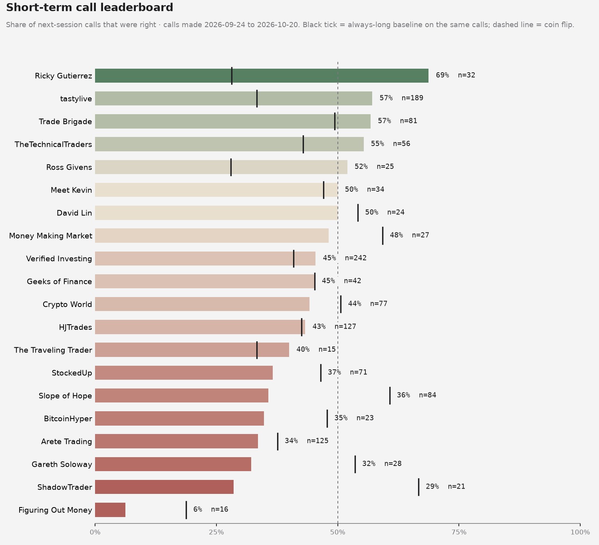
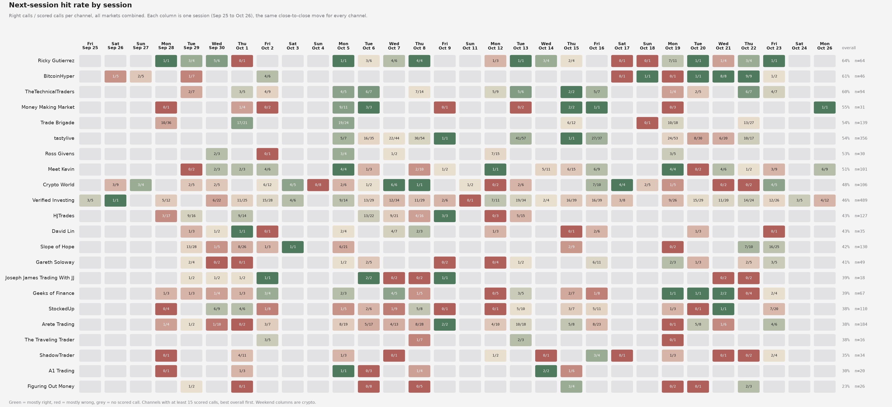
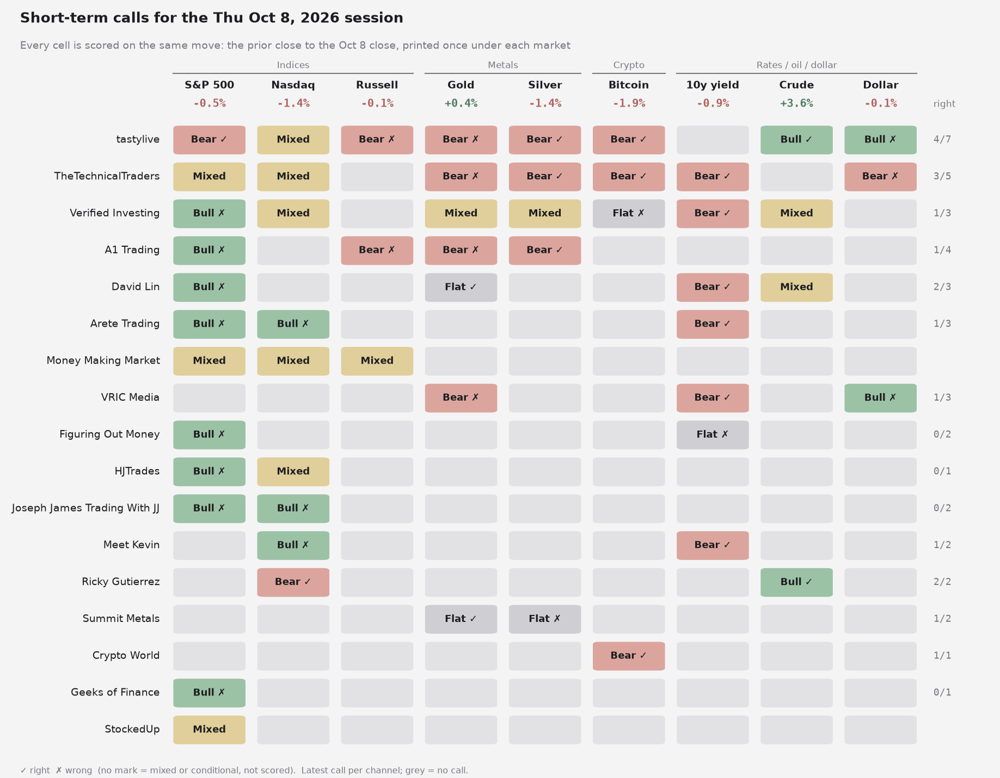
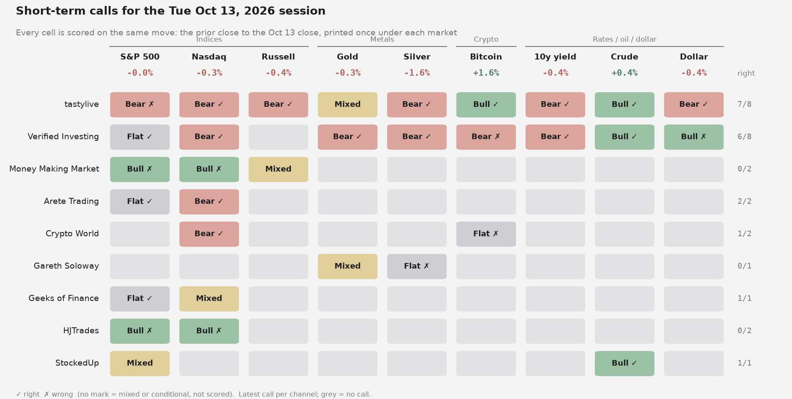
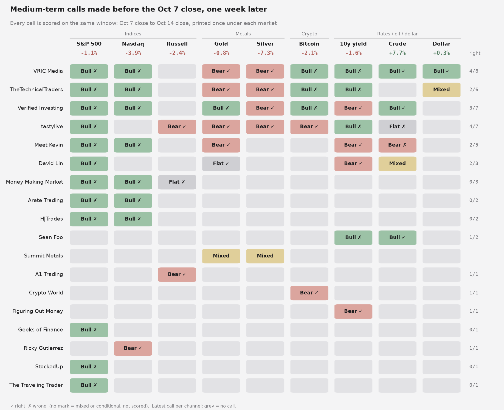

# youtube-call-scoreboard

**How often are YouTube market channels right about the next session?**

This repo extracts the short-term calls (bullish / bearish / neutral) that trading and market-analysis channels make
in their videos, scores each one against what the market actually did, and publishes every call, quote, timestamp
and score so creators and viewers can audit the result.

> **Not financial advice.** Scores reflect only each channel's *stated short-term bias* over a short pilot window.
> They say nothing about a channel's long-term views, education value, or trading performance.

## Pipeline

```
 channels.yaml
      │  ytscore ingest      YouTube captions (youtube-transcript-api) → rolling-caption dedupe
      ▼                       → transcripts/<id>.txt   (local only, git-ignored, never published)
 transcripts/
      │  ytscore extract     LLM (any OpenAI-compatible endpoint, e.g. OpenRouter) + prompts/extract.md
      ▼                       → validated JSON (pydantic), quotes ≤ 25 words
 data/calls/<id>.json
      │  ytscore score       Yahoo daily bars (yfinance) → reference close → next session / 1 week
      ▼                       → hit / miss with volatility thresholds, exclusions.yaml applied
 data/scored_calls.json
      │  ytscore leaderboard hit rate vs coin flip (binomial p) and vs an always-long baseline
      │  ytscore chart       out/session_heatmap.png, out/leaderboard.png
      ▼
 leaderboard
```

## Quickstart

```bash
git clone https://github.com/humbleambition/youtube-call-scoreboard
cd youtube-call-scoreboard
pip install -e ".[dev]"

# re-score the published calls exactly as in the snapshot below
ytscore score --asof 2026-10-21
ytscore leaderboard
ytscore chart
pytest

# process new videos
ytscore ingest --channels channels.yaml --days 2          # captions → transcripts/ (git-ignored)
cp .env.example .env                                      # add YTSCORE_LLM_API_KEY and YTSCORE_LLM_MODEL
ytscore extract transcripts/<id>.txt --channel "HJTrades" --date 2026-10-20
ytscore score && ytscore leaderboard && ytscore chart
```

Prices are cached in `.cache/prices/`. `--asof YYYY-MM-DD` uses only bars before that date, so a snapshot can be
re-created later (Yahoo occasionally revises past bars, so tiny differences are possible).

## Leaderboard snapshot (pilot: calls made 24 Sep – 20 Oct 2026)

Channels with at least 15 scored next-session calls. "Always-long" is the share of the same calls where the market
simply rose; "edge" is hit rate minus that baseline. With 20 channels compared, p-values above ~0.0025 are not
distinguishable from luck — none clear that bar yet.

| # | Channel | Next-session hit rate | Scored calls | Always-long baseline | Edge vs long | p (vs coin flip) | 1-week hit rate (n) |
|---|---|---|---|---|---|---|---|
| 1 | Ricky Gutierrez | 69% | 32 | 28% | +41 pts | 0.025 | 54% (39) |
| 2 | tastylive | 57% | 189 | 33% | +24 pts | 0.029 | 59% (231) |
| 3 | Trade Brigade | 57% | 81 | 49% | +7 pts | 0.133 | 51% (87) |
| 4 | TheTechnicalTraders | 55% | 56 | 43% | +12 pts | 0.252 | 53% (66) |
| 5 | Ross Givens | 52% | 25 | 28% | +24 pts | 0.500 | 39% (64) |
| 6 | Meet Kevin | 50% | 34 | 47% | +3 pts | 0.568 | 50% (101) |
| 7 | David Lin | 50% | 24 | 54% | -4 pts | 0.581 | 54% (74) |
| 8 | Money Making Market | 48% | 27 | 59% | -11 pts | 0.649 | 49% (35) |
| 9 | Verified Investing | 45% | 242 | 41% | +5 pts | 0.930 | 48% (287) |
| 10 | Geeks of Finance | 45% | 42 | 45% | +0 pts | 0.780 | 41% (54) |
| 11 | Crypto World | 44% | 77 | 51% | -6 pts | 0.873 | 48% (81) |
| 12 | HJTrades | 43% | 127 | 43% | +1 pts | 0.945 | 42% (165) |
| 13 | The Traveling Trader | 40% | 15 | 33% | +7 pts | 0.849 | 29% (34) |
| 14 | StockedUp | 37% | 71 | 46% | -10 pts | 0.992 | 48% (82) |
| 15 | Slope of Hope | 36% | 84 | 61% | -25 pts | 0.997 | 33% (143) |
| 16 | BitcoinHyper | 35% | 23 | 48% | -13 pts | 0.953 | 46% (24) |
| 17 | Arete Trading | 34% | 125 | 38% | -4 pts | 1.000 | 46% (181) |
| 18 | Gareth Soloway | 32% | 28 | 54% | -21 pts | 0.982 | 52% (25) |
| 19 | ShadowTrader | 29% | 21 | 67% | -38 pts | 0.987 | 35% (20) |
| 20 | Figuring Out Money | 6% | 16 | 19% | -12 pts | 1.000 | 32% (19) |






How each call is scored — reference close, windows, thresholds, baselines, limitations, and how to dispute a call —
is explained in **[docs/METHODOLOGY.md](docs/METHODOLOGY.md)**.

## What each channel called

Per-call heatmaps put every channel's call on each market side by side, scored over one shared window, with the actual move printed once per column.





Make your own: `ytscore chart --session 2026-10-08 --week 2026-10-07`

## Data

- `data/calls/` — one JSON file per video: channel, date, each call's biases, levels, a ≤ 25-word quote and its
  timestamp. No transcripts or captions are stored in this repo.
- `data/scored_calls.json` — every call with its reference close, next-session and one-week moves, and hit/miss.
- `data/leaderboard.json` — the table above as JSON.
- `channels.yaml`, `exclusions.yaml` — what is tracked, and what was excluded and why.

## Disputes

Think a call was misread? [Open an issue](https://github.com/humbleambition/youtube-call-scoreboard/issues/new)
with the video link and timestamp. See [Disputing a call](docs/METHODOLOGY.md#7-disputing-a-call).

## License

MIT © 2026 Jennifer Hsieh. Video content belongs to its creators; this repo stores only short quotes for
commentary and verification.
